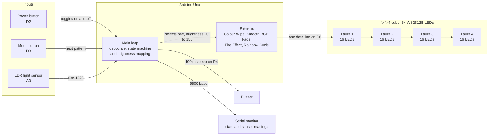

# NeoPixel LED Cube

This is a 4x4x4 NeoPixel LED cube built on an Arduino Uno as an academic engineering project. It runs four animated lighting patterns, adapts its brightness to ambient light through an LDR sensor and responds to two physical buttons for power and pattern control.

<h2 align="center">Project Walkthrough</h2>

<em>Click the video below to watch the full demo.</em>

https://github.com/user-attachments/assets/58bd4d04-e2ed-466e-9ed1-12fc8279b9ec

## Quick Start

1. Build the wiring setup described in [hardware/README.md](hardware/README.md).
2. Install Adafruit NeoPixel in Arduino IDE through Library Manager.
3. Open [software/neopixel_cube/neopixel_cube.ino](software/neopixel_cube/neopixel_cube.ino).
4. Select Arduino Uno and the correct COM port.
5. Upload and open Serial Monitor at 9600 baud.

## Core Features

- 64 addressable WS2812B LEDs in a 4x4x4 layout
- Four built-in animations: Colour Wipe, Smooth RGB Fade, Fire Effect and Rainbow Cycle
- Auto brightness mapping with an LDR sensor
- Real-time serial debug output
- Power and mode controls through physical buttons

## How It Fits Together

One data wire leaves D6 and runs through all 64 LEDs in a single chain, so each pattern writes the whole cube in one pass. The LDR reading sets the brightness for every frame and the two buttons are polled with software debounce, so the animations never block input.

## Tech Stack

|  |  |  |  |  |  |
|:---:|:---:|:---:|:---:|:---:|:---:|
| **Arduino** | **C++** | **C** | **Git** | **GitHub** | **VS Code** |

## Documentation Hub

  <a href="DOCUMENTATION.md">Documentation</a> &nbsp;•&nbsp;
  <a href="FAQ.md">FAQ</a> &nbsp;•&nbsp;
  <a href="hardware/README.md">Hardware Guide</a> &nbsp;•&nbsp;
  <a href="software/README.md">Software Guide</a> &nbsp;•&nbsp;
  <a href="media/Gallery.md">Gallery</a> &nbsp;•&nbsp;
  <a href="CONTRIBUTING.md">Contributing</a>

## Tested Environment

| Item                    | Tested Value             |
| ----------------------- | ------------------------ |
| Arduino IDE              | 2.x                       |
| Board                    | Arduino Uno (ATmega328P)  |
| LED Type                 | WS2812B                   |
| LED Count                | 64                        |
| Supply Used During Demo  | 5V DC, 2A+                |
| Serial Baud              | 9600                      |

## Citing This Work

> [!NOTE]
> This repository is registered with Zenodo and has a permanent, citable DOI: [10.5281/zenodo.21903764](https://doi.org/10.5281/zenodo.21903764). See [CITATION.cff](CITATION.cff) for the full citation. The "Cite this repository" option on GitHub can also be used.

## Contact and Support

> [!TIP]
> Questions are best raised as an issue in this repository first. You can also reach me directly at [eng@isaacadjei.me](mailto:eng@isaacadjei.me) or through [isaacadjei.me/contact](https://isaacadjei.me/contact).
